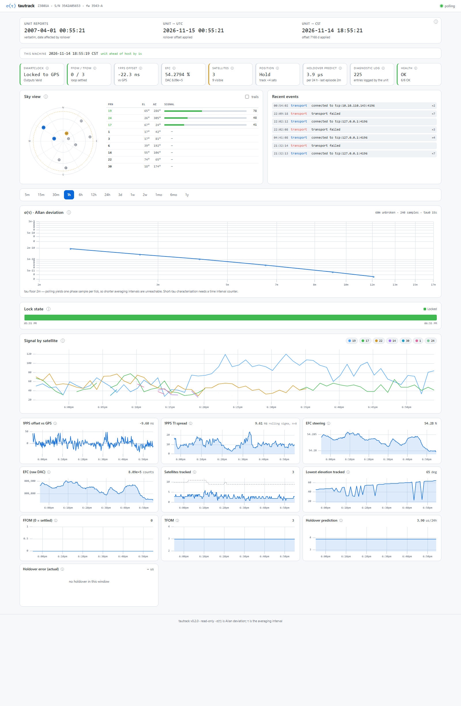
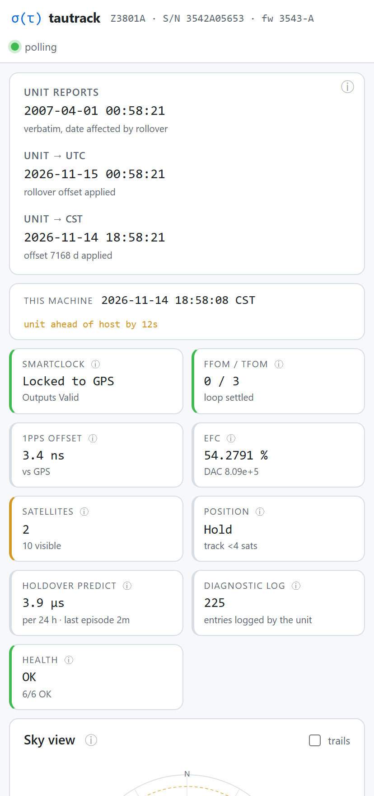

# tautrack

[](https://github.com/gx1400/tautrack/actions/workflows/ci.yml)
[](https://github.com/gx1400/tautrack/actions/workflows/release.yml)
[](https://github.com/gx1400/tautrack/releases)
[](https://github.com/gx1400/tautrack/pkgs/container/tautrack)
[](LICENSE)
[](AI_DISCLOSURE.md)

Monitoring, logging and trend analysis for GPS-disciplined oscillators (GPSDOs).

<br clear="left">

`tautrack` polls a GPSDO over serial or TCP, records its behaviour as time series,
and serves a read-only web UI for watching accuracy, stability and satellite
reception over spans from minutes to a year. Think of it as
[Smokeping](https://oss.oetiker.ch/smokeping/) for a frequency standard: the 1PPS
time interval behaves like latency, the lock/holdover state like packet loss.

The name is from **σ(τ)** — Allan deviation, the standard measure of oscillator
stability, where τ is the averaging interval.

> **Status: early development.** Nothing here is stable yet. The spec is still
> being written; see [`docs/`](docs/).

## Why

GPSDOs are long-horizon instruments. A unit can look healthy in a five-minute
glance and still be slowly losing its oscillator, drifting out of EFC range, or
sitting at a site that only achieves lock 70% of the time. The interesting
behaviour only shows up across hours, days and months:

- **Lock duty cycle** — what fraction of the time is it actually disciplined?
- **EFC trend** — the single best predictor of oven oscillator end-of-life.
- **Holdover prediction** — how well has the unit learned its own oscillator?
- **Satellite reception by elevation** — the metric that actually diagnoses
  antenna siting, as distinct from raw signal strength.

## Screenshots



Everything on one page, over a selectable span from five minutes to a year: the
&sigma;(&tau;) stability plot, a lock-state timeline whose colours also shade the
background of every sparkline below it, per-satellite signal strength, and the
current state as tiles. Every panel has a tooltip explaining what it measures.

Gaps in the data are drawn as gaps rather than interpolated across, and the charts
share one cursor, so hovering any of them reads every metric at the same instant.

<p align="center">
  
</p>

The layout reflows to a single column on a phone, which is the form most of this
gets read in.

[Lady Heather](http://www.ke5fx.com/heather/readme.htm) is the established tool in
this space and remains the reference for deep oscillator analysis. `tautrack`
aims at a different shape of problem: a headless service that runs continuously,
retains history at sensible resolution, exports to an existing observability
stack, and is readable from a phone.

## Hardware support

> **Tested against exactly one unit:** an **HP Z3801A**, serial 3542A05653,
> firmware **3543-A**. Nothing else has been verified against real hardware.

The Z3801A is the design target, and the SCPI-compatible siblings (Z3805A, HP
58503A, and the Lucent/Symmetricom units sharing the SmartClock firmware) are
*expected* to work but are unconfirmed. Treat them as untested.

The caution is not generic. Several things here were derived from this firmware's
actual output rather than from a specification, and are the parts most likely to
differ on another unit:

- The `:SYST:STAT?` screen is parsed by **column position**, discovered from the
  layout this firmware emits. A different layout will mis-parse rather than fail
  loudly.
- The date is corrected by a fixed **1024-week** offset for the GPS week rollover.
  Later firmware may not need it, or may need a different one.
- 1PPS TI is reported in **nanoseconds, or picoseconds below 1 ns** - a unit
  switch mid-field, and one that matters most when accuracy is best.
- Of the SCPI headers probed, **14 were rejected** as undefined by this firmware.
  The polled set in [`docs/command-map.md`](docs/command-map.md) is what this unit
  actually answers, not what the family supports.

If you run it against another unit, [`docs/command-map.md`](docs/command-map.md)
and the fixtures under `tests/` are the places to start, and a capture of your
`:SYST:STAT?` output is the single most useful thing to report.

Connected either directly over serial or through a serial device server such as the
Waveshare RS232/485/422 TO POE ETH (B) - one of the few that supports the 7 data bit /
odd parity line these units need. See [Connecting real hardware](#connecting-real-hardware).

## Quick start

No hardware required - the default transport replays a recorded session, so you can see
the UI immediately:

```bash
python -m venv .venv && . .venv/bin/activate     # Windows: .venv\Scripts\activate
pip install -e .
cp config.example.toml config.toml
tautrack serve
```

Then open <http://127.0.0.1:8080>.

Useful subcommands:

```bash
tautrack config       # print the effective configuration, after env overrides
tautrack poll-once    # one poll, printed to stdout; handy for checking a new device
```

## Connecting real hardware

Three transports, selected by `[transport] kind`:

| kind | Use when |
| --- | --- |
| `serial` | Direct USB/RS-232. In Docker this works **only on a Linux host**. |
| `tcp` | A serial device server. The portable option, and the intended end state. |
| `replay` | Development and CI. No device needed. |

The HP Z3801A runs **19200 7-O-1**, which is unusual - most equipment is 8-N-1, and a
device server that only offers 8-N-1 cannot talk to these units at all.

### Why TCP is the general answer

Docker Desktop runs a Linux VM on both Windows and macOS and cannot pass a host serial
device through. Rather than special-case those platforms, point a serial device server
at the instrument and use the `tcp` transport:

| Host | Transport | How |
| --- | --- | --- |
| Linux, direct USB | `serial` | `--device /dev/ttyUSB0` |
| Linux, gateway | `tcp` | hardware gateway or ser2net |
| Windows / macOS | `tcp` | [ser2net](https://github.com/cminyard/ser2net) (ships Windows and macOS builds) |

A ready-made [`ser2net.yaml`](ser2net.yaml) is included. If ser2net is not installed
yet, `tools/ser2net_emu.py` reads the *same* config, so swapping in the real binary
later changes nothing but the command:

```bash
python tools/ser2net_emu.py -c ser2net.yaml -n    # before install
ser2net                     -c ser2net.yaml -n    # after
```

**One configuration trap worth knowing.** Device servers often default to sending a
banner, heartbeat or registration packet. Those bytes arrive inside the reply stream
and corrupt the parse intermittently, which looks like a faulty instrument rather than
a misconfiguration. Turn them all off. For the same reason, allow exactly **one**
client: SCPI is request/response against shared device state, so a second reader
consumes the first's replies.

## Configuration

TOML, with environment overrides using `TAUTRACK_` and `__` for nesting. Precedence is
**environment > file > defaults**, so a mounted config can be overridden per
deployment:

```bash
TAUTRACK_TRANSPORT__KIND=tcp TAUTRACK_TRANSPORT__TCP__HOST=10.0.0.5 tautrack serve
```

See [`config.example.toml`](config.example.toml) for every option.

The web UI binds **loopback by default**. There is no authentication, so exposing it is
a deliberate choice:

```toml
[web]
host = "0.0.0.0"
```

## Docker

The quickest route is Compose. [`docker-compose.example.yml`](docker-compose.example.yml)
is annotated and ready to copy:

```bash
cp docker-compose.example.yml docker-compose.yml
# edit the TAUTRACK_TRANSPORT__TCP__HOST line to point at your device server
docker compose up -d
```

It publishes to `127.0.0.1:8080` rather than every interface, because there is no
authentication; drop the prefix deliberately if you want it on the LAN.

Or directly:

```bash
docker run -d --name tautrack \
  --restart unless-stopped \
  -p 8080:8080 \
  -v tautrack-data:/data \
  -e TAUTRACK_TRANSPORT__KIND=tcp \
  -e TAUTRACK_TRANSPORT__TCP__HOST=host.docker.internal \
  ghcr.io/gx1400/tautrack:latest
```

On a Linux host you can use the serial transport directly instead:

```bash
docker run -d --name tautrack \
  --restart unless-stopped \
  --device /dev/ttyUSB0 --group-add dialout \
  -e TAUTRACK_TRANSPORT__KIND=serial \
  -e TAUTRACK_TRANSPORT__SERIAL__PORT=/dev/ttyUSB0 \
  -p 8080:8080 -v tautrack-data:/data \
  ghcr.io/gx1400/tautrack:latest
```

Use a restart policy (`--restart unless-stopped`) rather than an external supervisor;
the container already has a healthcheck.

### Update notifications

Once a day the server asks GitHub whether a newer release exists, and shows a
dismissable banner if so - with the matching `docker pull` command when running in a
container. Dismissal is remembered per version, so declining one release does not
hide the next.

The check is deliberately unobtrusive: it runs on a background loop rather than the
request path, never blocks startup or polling, and every failure is silent. A host
with no route to the internet behaves identically, minus the banner. Turn it off with
`TAUTRACK_UPDATE__ENABLED=false` or `enabled = false` under `[update]`.

### Software bill of materials

Every [release](https://github.com/gx1400/tautrack/releases) carries a
[CycloneDX](https://cyclonedx.org/) SBOM, `tautrack-<version>.cdx.json`, listing the
Python packages tautrack runs on with their exact versions, licences and package URLs.
It is generated from a clean, runtime-only install on the container's Python, so it
describes what the image ships, not the development environment. Python packages only:
the base image's Debian packages are not included.

To generate one locally:

```bash
python tools/sbom.py        # -> dist/tautrack-<version>.cdx.json
```

## Importing existing data

`tools/backfill.py` imports a captured session at its original timestamps, so long-span
charts are populated from the start rather than filling in over weeks.

## Development

```bash
pip install -e ".[dev]"
pytest -q
ruff check . && ruff format --check .
```

Tests run against **recorded hardware responses**, so the whole suite passes with no
device attached. The fixtures deliberately cover the awkward real states - a status
screen with no tracked-satellite table, positions labelled `INIT`/`AVG`/held, 1PPS
offsets reported in picoseconds rather than nanoseconds, and replies arriving split
across several reads.

## Licence

[MIT](LICENSE).

Lady Heather and other existing tools inform *scope* here, via their published
documentation. No code is taken from them — tautrack is MIT and must stay free of
copyleft-licensed source.

## AI assistance

See [AI_DISCLOSURE.md](AI_DISCLOSURE.md).
